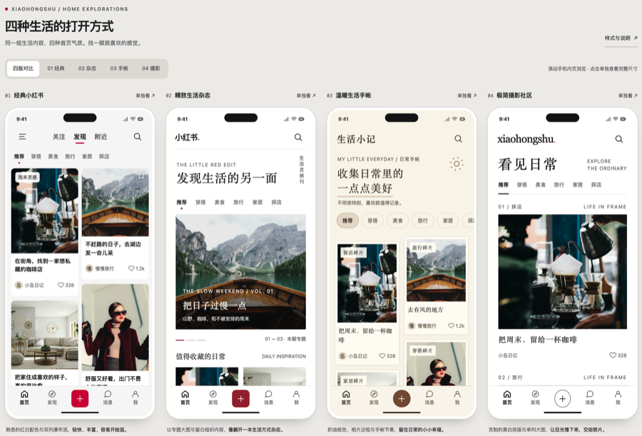

# Design UI UX — AI Agent Skill for HTML + Tailwind Prototypes

[English](README.md) | [简体中文](README.zh-CN.md) | [繁體中文](README.zh-TW.md) | [日本語](README.ja.md) | [한국어](README.ko.md) | [Español](README.es.md) | [Français](README.fr.md) | Deutsch

Ein UI/UX-Skill für Coding-Assistenten: Wähle eine Designvorlage und einen Stil. Daraus entsteht ein HTML + Tailwind-Prototyp, den du direkt im Browser öffnen kannst.

## Installation

Führe diesen Befehl im Projektordner aus:

```bash
npx skills add ducafecat/design-ui-ux
```

## Verwendung

### 1. Designreferenzen suchen

Beschreibe, was du bauen möchtest, für wen und mit welchen Ansichten. Falls du ein Anforderungsdokument (PRD) hast, gib den Dateipfad an:

```text
/design-ui-ux Entwirf eine mobile Oberfläche im Stil von Xiaohongshu.

Referenz:
docs/prd.md
```


### 2. Designrichtung auswählen

Such dir eine passende Referenz aus. Ist nichts dabei, lass dir weitere zeigen:

```text
Zeige mir eine weitere Auswahl an Referenzen.
```


### 3. Prototyp erstellen

Antworte mit der Kennung deiner Referenz, zum Beispiel:


```text
B2
```

Wähle anschließend einen Stil:


Für die erste Option antworte mit:

```text
1
```

Nach der Bestätigung wird der Prototyp in `design/index.html` gespeichert. Öffne die Datei zur Vorschau im Browser.


### 4. Ansichten nebeneinander anzeigen

Lass dir alle Ansichten auf einer Seite zusammenstellen:

```text
Ordne die Ansichten aus design/index.html nebeneinander an und speichere sie in design/平铺.html.
```

Ergebnisdatei: `design/平铺.html`


### 5. Mehrere Entwürfe vergleichen

Noch unsicher? Lass für jeden Stil eine Startseite erstellen:

```text
Erstelle je eine Startseite für die Optionen 1, 2, 3 und 4 und speichere sie in design/compare.html.
```

Ergebnisdatei: `design/compare.html`



## Voraussetzungen

- Die Installation benötigt Node.js 22.20 oder neuer sowie npm / npx. Die erzeugten HTML-Seiten benötigen kein Node.js.
- Die lokale Datensuche benötigt Python 3, aber keine Drittanbieterpakete. Ohne Python kannst du Seiten anhand der Designrichtlinien erstellen; die lokale Suche steht dann nicht zur Verfügung.
- Für Referenzsuche und Seitenprüfung brauchst du einen Browser mit Screenshots und Vorschau lokaler HTML-Dateien. Standard ist Ego Lite; der Skill `ego-browser` muss separat eingerichtet werden. Andere Browser sind gemäß den Skill-Anweisungen möglich.
- Tailwind muss während der Entwicklung kompiliert werden. Kompiliere es vor der Übergabe, damit die fertige HTML-Datei ohne Node.js, CDN oder Build zur Laufzeit geöffnet werden kann.

## Feedback und Lizenz

Lies vor Verbesserungsvorschlägen [CONTRIBUTING.md](CONTRIBUTING.md). Die Versionshistorie steht in [CHANGELOG.md](CHANGELOG.md), Hinweise zu vertraulichen Problemen in [SECURITY.md](SECURITY.md). Melde reproduzierbare Fehler über [GitHub Issues](https://github.com/ducafecat/design-ui-ux/issues).

Dieses Projekt steht unter der [MIT-Lizenz](LICENSE). Code, Daten, Schriftarten, Bilder und andere Inhalte Dritter unterliegen weiterhin ihren jeweiligen Lizenzen. Angaben zu den ursprünglichen Projekten und Quellen stehen in [NOTICE.md](NOTICE.md).
