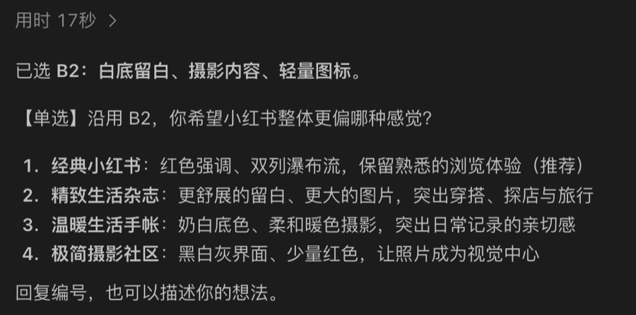

# Design UI UX — AI Agent Skill for HTML + Tailwind Prototypes

[English](README.md) | [简体中文](README.zh-CN.md) | [繁體中文](README.zh-TW.md) | [日本語](README.ja.md) | [한국어](README.ko.md) | [Español](README.es.md) | [Français](README.fr.md) | Deutsch

Erstelle UI/UX-Prototypen mit HTML + Tailwind. Suche Designreferenzen, wähle einen Stil und erstelle Seiten, die du im Browser ansehen kannst.

## Installation

Installiere mit npx, vorzugsweise im aktuellen Projekt:

```bash
npx skills add ducafecat/design-ui-ux
```

## Verwendung

### 1. Designreferenzen suchen

Bereite ein Dokument mit Produktanforderungen (PRD) vor: Was möchtest du erstellen, für wen und mit welchen Ansichten? Gib anschließend Folgendes ein:

```text
/design-ui-ux Entwirf eine mobile Oberfläche im Stil von Xiaohongshu.

Referenz:
docs/prd.md
```


### 2. Designrichtung auswählen

Wähle eine passende Richtung aus den Ergebnissen. Falls keine passt, bitte um weitere Vorschläge:

```text
Zeige mir eine weitere Auswahl an Referenzen.
```


### 3. Prototyp erstellen

Gib die Kennung der gewählten Referenz ein, zum Beispiel B2. Wähle danach einen der vorgeschlagenen Stile, etwa Option 1.


```text
B2
```



Beispiel für die Auswahl von Option 1:

```text
1
```

Nach der Bestätigung wird der Prototyp in `design/index.html` gespeichert. Öffne die Datei zur Vorschau im Browser.


### 4. Ansichten nebeneinander anzeigen

Um alle Ansichten gemeinsam zu betrachten, gib Folgendes ein:

```text
Ordne die Ansichten aus design/index.html nebeneinander an und speichere sie in design/平铺.html.
```

Ergebnisdatei: `design/平铺.html`


### 5. Mehrere Entwürfe vergleichen

Wenn du dich nicht für einen Stil entscheiden kannst, erstelle für jeden eine Startseite und vergleiche sie:

```text
Erstelle je eine Startseite für die Optionen 1, 2, 3 und 4 und speichere sie in design/compare.html.
```

Ergebnisdatei: `design/compare.html`


## Voraussetzungen

- Die Installation benötigt Node.js 22.20 oder neuer sowie npm / npx. Die erzeugten HTML-Seiten benötigen kein Node.js.
- Die lokale Datensuche benötigt Python 3, aber keine Drittanbieterpakete. Ohne Python kannst du Seiten anhand der Designrichtlinien erstellen; die lokale Suche steht dann nicht zur Verfügung.
- Für Referenzsuche und Seitenprüfung brauchst du einen Browser mit Screenshots und Vorschau lokaler HTML-Dateien. Standard ist Ego Lite; der Skill `ego-browser` muss separat eingerichtet werden. Andere Browser sind gemäß den Skill-Anweisungen möglich.
- Tailwind muss während der Entwicklung kompiliert werden. Kompiliere es vor der Übergabe, damit die fertige HTML-Datei ohne Node.js, CDN oder Build zur Laufzeit geöffnet werden kann.

## Feedback, Wartung und Lizenz

Lies vor Verbesserungsvorschlägen [CONTRIBUTING.md](CONTRIBUTING.md). Die Versionshistorie steht in [CHANGELOG.md](CHANGELOG.md), Hinweise zu vertraulichen Problemen in [SECURITY.md](SECURITY.md). Melde reproduzierbare Fehler über [GitHub Issues](https://github.com/ducafecat/design-ui-ux/issues).

Für das Projekt wurde noch keine Lizenz festgelegt. Prüfe vor Nutzung oder Weiterverteilung die erforderlichen Berechtigungen. Vor einer Veröffentlichung muss der Maintainer Quellen, Weiterverteilungsrechte und Lizenzen für Code und Daten prüfen. Eine Quellenangabe allein erteilt keine Erlaubnis zur Weiterverteilung. Siehe den [Herkunftshinweis](NOTICE.md).
