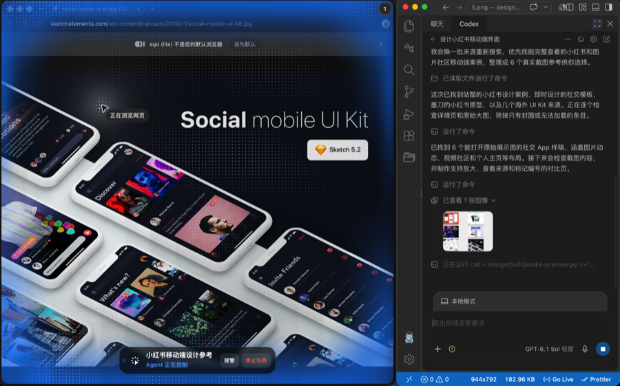
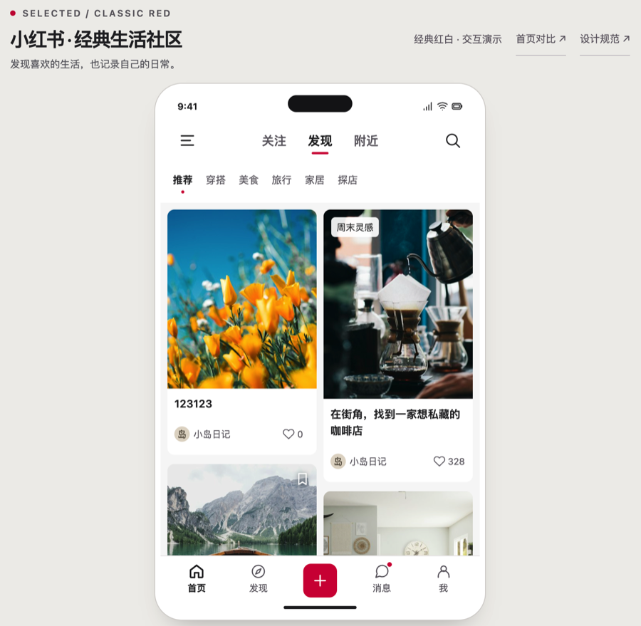
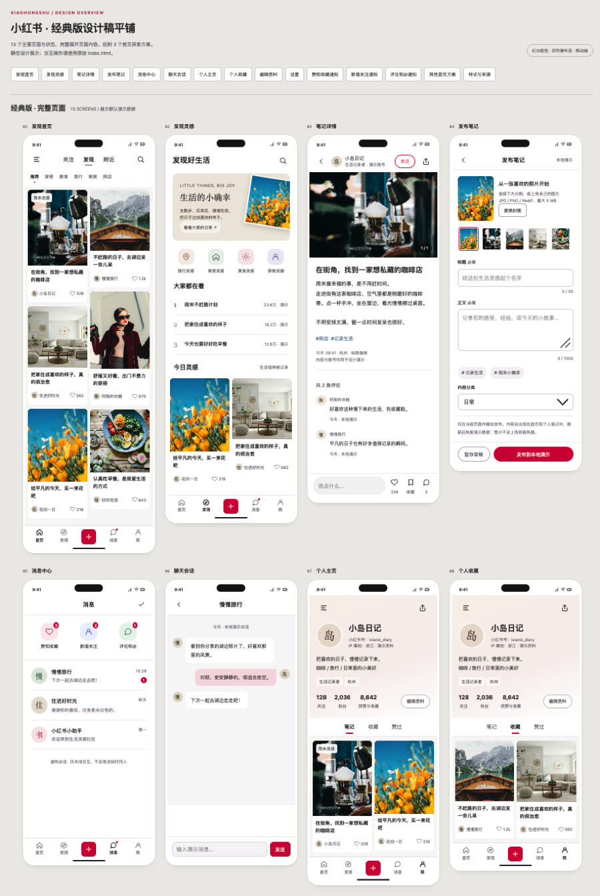

# Design UI UX — AI Agent Skill for HTML + Tailwind Prototypes

English | [简体中文](README.zh-CN.md) | [繁體中文](README.zh-TW.md) | [日本語](README.ja.md) | [한국어](README.ko.md) | [Español](README.es.md) | [Français](README.fr.md) | [Deutsch](README.de.md)

A UI/UX design skill for coding agents. Pick a reference, settle on a style, and turn your requirements into an HTML + Tailwind prototype you can open in a browser.

## Installation

Run this from your project folder:

```bash
npx skills add ducafecat/design-ui-ux
```

## How to use

### 1. Find design references

Describe what you’re building, who will use it, and which screens you need. If you have a product requirements document (PRD), include its path:

```text
/design-ui-ux Design a Xiaohongshu-style mobile UI

Reference:
docs/prd.md
```



### 2. Choose a design direction

Choose a reference you like. If nothing fits, ask for another set:

```text
Show me another batch
```


### 3. Create the prototype


Reply with the reference ID, such as:

```text
B2
```

Then choose a style:


To choose the first option, reply:

```text
1
```

Once you confirm the style, the skill builds the prototype in `design/index.html`. Open the file in your browser to try it.



### 4. View the pages side by side

Ask for a page that shows all screens together:

```text
Arrange the views from design/index.html side by side and save them to design/平铺.html
```

Open `design/平铺.html` to see the screens together:



### 5. Compare designs

Still deciding? Ask for a homepage in each style:

```text
Create one homepage design for each of options 1, 2, 3, and 4, and save them to design/compare.html
```

Open `design/compare.html` to compare the options:


## Requirements

- **Installation:** Node.js 22.20 or later, with npm / npx. You won’t need Node.js to view the finished HTML.
- **Local search:** Python 3, with no extra packages. Without it, the skill can still follow the design guidelines, but can’t search the local data.
- **Browser:** Screenshot capture and local HTML preview support. The default is Ego Lite; set up the `ego-browser` skill separately. Other browsers can be used as described in the skill instructions.
- **Tailwind:** Compile the styles before delivery. The finished HTML should open without Node.js, a CDN, or a build step.

## Feedback and license

Found a bug? Open a [GitHub Issue](https://github.com/ducafecat/design-ui-ux/issues) with steps to reproduce it. For sensitive reports, follow [SECURITY.md](SECURITY.md). See [CONTRIBUTING.md](CONTRIBUTING.md) to contribute and [CHANGELOG.md](CHANGELOG.md) for changes.

This project is licensed under the [MIT License](LICENSE). Third-party code, data, fonts, images, and other assets remain subject to their respective licenses. See [NOTICE.md](NOTICE.md) for upstream attribution and source records.
