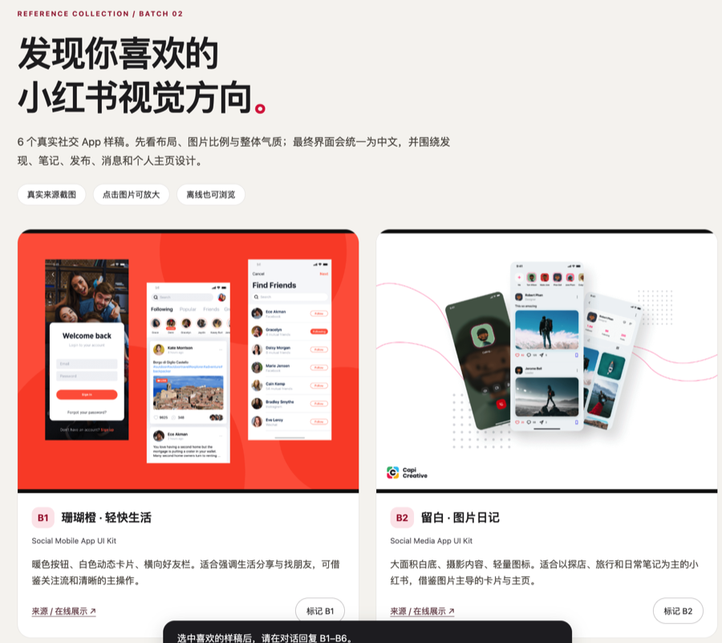

# Design UI UX — AI Agent Skill for HTML + Tailwind Prototypes

[English](README.md) | 简体中文 | [繁體中文](README.zh-TW.md) | [日本語](README.ja.md) | [한국어](README.ko.md) | [Español](README.es.md) | [Français](README.fr.md) | [Deutsch](README.de.md)

用 HTML + Tailwind 制作 UI/UX 原型。从查找设计参考、选择风格，到生成可在浏览器中预览的页面，按下面的步骤就能开始。

[猫哥Flutter视频学习站](https://ducafecat.com/)

[Flutter插件站](https://flutter.ducafecat.com/)

## 安装

通过 npx 安装，建议安装到当前项目：

```bash
npx skills add ducafecat/design-ui-ux
```

## 使用流程

### 1、查找设计参考

建议先准备一份产品需求文档（PRD），说明要做什么、给谁用、需要哪些页面。然后输入：

```text
/design-ui-ux 设计一个小红书风格的移动端界面

参考
docs/prd.md
```


### 2、选择设计方向

从搜索结果中挑选喜欢的方向。如果这一批都不合适，可以继续输入：

```text
再换一批
```



### 3、生成设计稿


输入选中的参考编号，例如：

```text
B2
```

接下来会给出具体的风格选项，选一个符合预期的：


例如，选择第 1 项：

```text
1
```

确认后，设计稿会保存到 `design/index.html`，可在浏览器中打开预览。


### 4、平铺设计稿

想把各个页面放在一起查看，可以输入：

```text
将设计稿 design/index.html，平铺保存到 design/平铺.html
```

结果保存到 `design/平铺.html`：


### 5、对比多个方案

拿不准选哪种风格时，可以让它分别做一版首页，放在一起比较：

```text
1 2 3 4 各出一个首页设计，保存到 design/compare.html
```

结果保存到 `design/compare.html`：


## 环境要求

- 安装时需要 Node.js 22.20 或更高版本，以及 npm / npx。生成的 HTML 页面不需要 Node.js。
- 本地数据检索需要 Python 3，无需安装第三方包。没有 Python 时，仍可按设计规范制作页面，但无法使用本地检索。
- 查找参考和检查页面需要浏览器，支持实际截图和本地 HTML 预览。默认使用 Ego Lite，需单独配置 `ego-browser` 技能；也可按技能说明使用其他浏览器。
- 制作页面时需要编译 Tailwind。交付前应完成编译，让最终 HTML 无需 Node.js、CDN 或运行时构建即可打开。

## 反馈、维护与许可

提交改进前请阅读 [CONTRIBUTING.md](CONTRIBUTING.md)，版本记录见 [CHANGELOG.md](CHANGELOG.md)，敏感问题见 [SECURITY.md](SECURITY.md)。通过 [GitHub Issues](https://github.com/ducafecat/design-ui-ux/issues) 反馈可复现问题。

项目目前尚未指定许可证。使用或分发前，请确认相关授权；维护者也需在发布前核实代码与数据的来源、再分发权及许可证。数据中标注了来源，并不代表已获得再分发许可，详见 [来源说明](NOTICE.md)。
