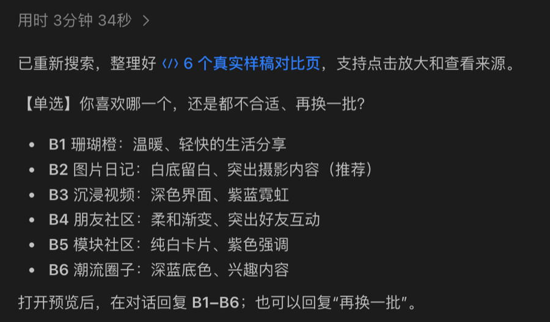

# Design UI UX — AI Agent Skill for HTML + Tailwind Prototypes

[English](README.md) | 简体中文 | [繁體中文](README.zh-TW.md) | [日本語](README.ja.md) | [한국어](README.ko.md) | [Español](README.es.md) | [Français](README.fr.md) | [Deutsch](README.de.md)

一个给编程助手用的 UI/UX 设计技能。先看参考、选风格，再把需求做成 HTML + Tailwind 原型，打开浏览器就能查看。

[猫哥Flutter视频学习站](https://ducafecat.com/)

[Flutter插件站](https://flutter.ducafecat.com/)

## 安装

在项目目录中运行：

```bash
npx skills add ducafecat/design-ui-ux
```

## 使用流程

### 1、查找设计参考

说清楚要做什么、给谁用、需要哪些页面。如果已有产品需求文档（PRD），可以直接附上路径：

```text
/design-ui-ux 设计一个小红书风格的移动端界面

参考
docs/prd.md
```


### 2、选择设计方向

挑一个喜欢的参考。都不合适就让它再找一批：

```text
再换一批
```


### 3、生成设计稿



回复参考编号，比如：

```text
B2
```

再从给出的风格中选一个：


选第 1 项就回复：

```text
1
```

确认风格后，技能会开始制作，设计稿保存在 `design/index.html`。用浏览器打开即可查看和操作。


### 4、平铺设计稿

想把几个页面放在一起看，可以这样说：

```text
将设计稿 design/index.html，平铺保存到 design/平铺.html
```

打开 `design/平铺.html`，就能一起查看各个页面：


### 5、对比多个方案

拿不准风格，就各做一版首页再比较：

```text
1 2 3 4 各出一个首页设计，保存到 design/compare.html
```

打开 `design/compare.html` 比较各个方案：


## 环境要求

- **安装：** Node.js 22.20 或更高版本，以及 npm / npx。查看成品 HTML 不需要 Node.js。
- **本地检索：** Python 3，无需额外安装包。没有 Python 也能按设计规范制作页面，只是不能检索本地数据。
- **浏览器：** 需要支持截图和本地 HTML 预览。默认使用 Ego Lite，先单独配置 `ego-browser` 技能；其他浏览器的用法见技能说明。
- **Tailwind：** 制作时需要编译样式。交付前完成编译，成品 HTML 应能直接打开，无需 Node.js、CDN 或现场构建。

## 反馈与许可

遇到问题，可以在 [GitHub Issues](https://github.com/ducafecat/design-ui-ux/issues) 中附上复现步骤。敏感问题按 [SECURITY.md](SECURITY.md) 私下报告。参与改进请看 [CONTRIBUTING.md](CONTRIBUTING.md)，更新记录见 [CHANGELOG.md](CHANGELOG.md)。

本项目采用 [MIT 许可证](LICENSE)。第三方代码、数据、字体、图片及其他素材仍遵循各自的许可条款。上游署名与来源记录见 [NOTICE.md](NOTICE.md)。
